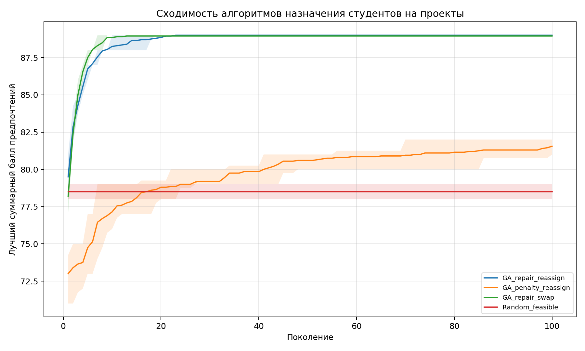
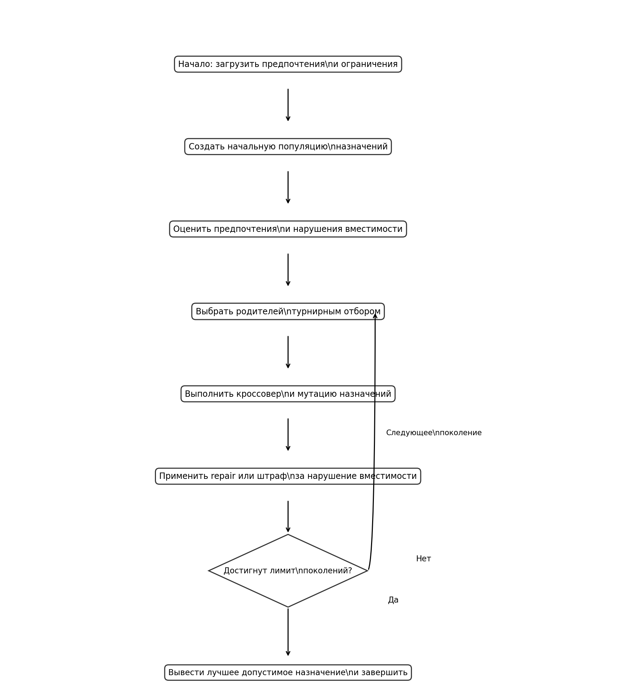

# Лабораторная работа № 2 — Генетический алгоритм для дискретной задачи

**Дисциплина:** «Эволюционное программирование и генетические алгоритмы»  
**Индивидуальный вариант:** 8  
**Язык:** Python 3

## Цель работы

Реализовать генетический алгоритм для дискретной задачи назначения студентов на проекты с учётом индивидуальных предпочтений и вместимости команд. Сравнить два способа обработки ограничений, варианты мутации и случайный допустимый поиск.

## Постановка задачи

Требуется назначить каждого из 20 студентов ровно на один из 5 проектов так, чтобы вместимость ни одного проекта не была превышена, а суммарный балл предпочтений был максимальным.

Пусть \(a_i\in\{0,1,2,3,4\}\) — номер проекта, назначенного студенту \(i\). Матрица предпочтений \(p_{ij}\) содержит баллы от 1 до 5. Целевая функция:

\[
\max S(a)=\sum_{i=1}^{20}p_{i,a_i}.
\]

Ограничения вместимости:

\[
\sum_{i=1}^{20}[a_i=j]\leq c_j,
\]

где вместимости проектов равны **[5, 4, 4, 4, 5]**. Каждый студент получает ровно одно назначение за счёт представления решения в виде вектора длины 20.

## Входные данные

В `preferences.csv` содержится матрица предпочтений 20 студентов к 5 проектам. Это синтетические данные: целочисленные баллы от 1 до 5 сгенерированы равномерно с фиксированным seed `2026`; это не реальный опрос студентов.

## Кодирование и операторы

- **Генотип:** целочисленный вектор длины 20; каждая координата — проект, назначенный соответствующему студенту.
- **Начальная популяция:** допустимые назначения создаются выбором слотов с учётом вместимостей.
- **Селекция:** турнирный отбор из трёх особей.
- **Кроссовер:** для каждого студента случайно выбирается назначение от одного из родителей.
- **Мутация `reassign`:** выбранному студенту назначается другой проект.
- **Мутация `swap`:** назначения двух студентов меняются местами; количества студентов по проектам при такой мутации не меняются.
- **Обработка ограничений `repair`:** студенты из переполненной команды переводятся в проекты, где есть свободные места, с учётом их предпочтений.
- **Обработка ограничений `penalty`:** целевая оценка уменьшается на штраф за превышение вместимости.
- **Элитизм:** лучшая особь переносится в следующее поколение.

## Эксперимент

Проведено 20 запусков для каждой конфигурации, seed от `42` до `61`, по 100 поколений при размере популяции 100 особей. Случайный поиск оценивает 10 000 допустимых кандидатов на запуск. Сравнивались:

1. `GA_repair_reassign` — восстановление допустимости и переназначение студентов;
2. `GA_penalty_reassign` — штраф за превышение вместимости и переназначение студентов;
3. `GA_repair_swap` — восстановление допустимости и обмен назначений двух студентов;
4. `Random_feasible` — случайный поиск по допустимым назначениям.

### Сводные результаты

| Метод | Лучший балл | Средний | Медиана | Ст. отклонение | Худший | Доля допустимых |
|---|---:|---:|---:|---:|---:|---:|
| `GA_penalty_reassign` | 85.00 | 81.55 | 81.00 | 1.36 | 80.00 | 100% |
| `GA_repair_reassign` | 89.00 | 89.00 | 89.00 | 0.00 | 89.00 | 100% |
| `GA_repair_swap` | 89.00 | 88.95 | 89.00 | 0.22 | 88.00 | 100% |
| `Random_feasible` | 81.00 | 78.50 | 78.50 | 1.40 | 76.00 | 100% |

### Лучшее найденное распределение

Лучший допустимый результат — **89 баллов**, метод: `GA_repair_reassign`.

| Проект | Вместимость | Назначено | Студенты |
|---|---:|---:|---|
| AI | 5 | 5 | Студент_01, Студент_03, Студент_09, Студент_11, Студент_14 |
| Computer_Vision | 4 | 4 | Студент_04, Студент_07, Студент_10, Студент_17 |
| Data_Analysis | 4 | 4 | Студент_06, Студент_15, Студент_16, Студент_18 |
| Robotics | 4 | 4 | Студент_02, Студент_05, Студент_12, Студент_20 |
| Software_Engineering | 5 | 3 | Студент_08, Студент_13, Студент_19 |

### Графики

#### Сходимость алгоритмов



#### Блок-схема



## Примеры допустимых и недопустимых решений

- **Допустимое:** количества студентов по проектам `[5, 4, 4, 4, 3]` — ни одна вместимость не превышена.
- **Недопустимое:** назначить всех 20 студентов проекту `AI`: вместимость равна 5, превышение составляет 15 человек.
- **Ещё один допустимый пример:** `[4, 4, 4, 4, 4]`.
- **Ещё один недопустимый пример:** `[6, 3, 4, 4, 3]`, так как вместимость `AI` превышена.

## Выводы

В данной серии запусков метод `GA_repair_reassign` получил средний балл **89.00**, а случайный допустимый поиск — **78.50**. Средний результат штрафного подхода `GA_penalty_reassign` составил **81.55**. На этом синтетическом наборе данных ремонт ограничений оказался эффективнее штрафного подхода и случайного поиска. Этот вывод относится к выбранным данным и параметрам эксперимента и не является универсальным для всех задач назначения.

Доля допустимых итоговых решений для всех методов составила 100%; средняя перегрузка равна нулю. Результаты и графики созданы одним запуском программы с указанными параметрами.

## Структура проекта

```text
LR2_variant8_fixed/
├── main.py
├── README.md
├── preferences.csv
├── results.csv
├── summary.csv
├── best_assignment.csv
├── experiment_summary.txt
├── convergence.png
└── flowchart.png
```

## Установка и запуск

Требуется Python 3.

```bash
python -m pip install numpy pandas matplotlib
python main.py --runs 20 --seed 42 --generations 100
```

Программа сохраняет `results.csv`, `summary.csv`, `best_assignment.csv`, `convergence.png` и `flowchart.png`.
